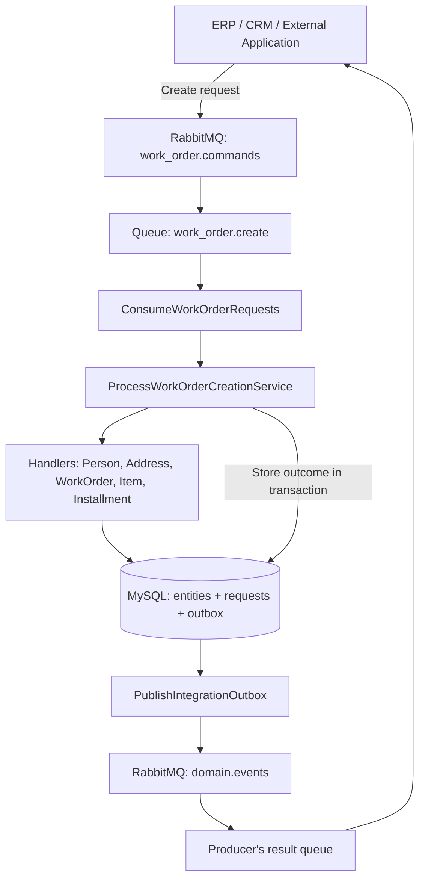

# Work Order API

**A multi-tenant work order management service built with Laravel 11, PHP 8.3, MySQL 8, Domain-Driven Design (DDD), and RabbitMQ.**

Work Order API manages customers, addresses, work orders, service items, and payment installments. Alongside versioned HTTP endpoints, the system is being extended to accept asynchronous work order creation requests, execute related operations in a single database transaction, and publish success or rejection outcomes back to the requesting system.

> [!IMPORTANT]
> **Project status: under active development.** RabbitMQ consumption of `customer.created` and `customer.updated` events, local customer projection, and sequential duplicate detection have been validated in a development environment. The complete **asynchronous work order creation flow** has an initial implementation, but still requires integration with the actual tenant context, alignment with existing Commands/Handlers and Value Objects, and end-to-end testing before production use.

## Table of contents

- [Overview](#overview)
- [Technology stack](#technology-stack)
- [Architecture](#architecture)
- [Domain model](#domain-model)
- [Asynchronous processing](#asynchronous-processing)
- [Messaging contracts](#messaging-contracts)
- [Atomicity and idempotency](#atomicity-and-idempotency)
- [Getting started](#getting-started)
- [Operational commands](#operational-commands)
- [Testing and code quality](#testing-and-code-quality)
- [Security and observability](#security-and-observability)
- [Roadmap](#roadmap)
- [License](#license)

## Overview

Work Order API serves HTTP clients and external systems that communicate through RabbitMQ. Its purpose is to keep work order business rules and persistence within a dedicated service, rather than requiring the originating application to separately create a customer, address, work order, items, and installments.

**Architectural goals:**

- Keep domain rules, application use cases, and infrastructure concerns separate.
- Support asynchronous integration without coupling every operation to synchronous HTTP calls.
- Make related database writes atomic through a single MySQL transaction.
- Prevent duplicate work orders using business-request idempotency.
- Persist outgoing results through the **Transactional Outbox** pattern.
- Enforce tenant isolation using explicit mapping between external and local tenant identifiers.
- Distinguish permanent business rejections from transient infrastructure failures.

## Technology stack

| Area | Technology / approach |
| --- | --- |
| Language | PHP 8.3 |
| Framework | Laravel 11 |
| Database | MySQL 8 |
| Message broker | RabbitMQ (AMQP) |
| AMQP client | `php-amqplib/php-amqplib` |
| Runtime | Docker / Docker Compose |
| Architecture | DDD; Domain, Application, and Infrastructure layers |
| Integration patterns | Command Messaging, integration events, asynchronous request–reply |
| Reliability | Transactional Inbox / Outbox, manual ACK/NACK, dead-letter queues |
| Testing and quality | PHPUnit, Laravel Pint, PSR-12 |

> The initial setup used `php-amqplib` **2.8.0**. Upgrade to a maintained, compatible release and review its API before deploying to production. The current consumer uses channel-level `basic_ack()` / `basic_nack()` for compatibility with that version.

## Architecture



### Layer responsibilities

| Layer | Responsibility | Examples |
| --- | --- | --- |
| **Domain** | Business entities, Value Objects, and invariants | `Person`, `Address`, `WorkOrder`, `WorkOrderItem`, `WorkOrderInstallment` |
| **Application** | Commands, Handlers, validation, and use-case orchestration | `CreateWorkOrderHandler`, `ProcessWorkOrderCreationService` |
| **Infrastructure** | Eloquent persistence, mappers, RabbitMQ, and external integrations | Eloquent repositories, `RabbitMQConnectionFactory` |
| **Entrypoints** | HTTP endpoints and operational consumers | API V1 controllers, Artisan commands |

### Relevant project structure

```text
app/
├── Application/
│   ├── Commands/V1/
│   ├── Handlers/V1/
│   ├── Messaging/
│   │   ├── IntegrationEvent.php
│   │   ├── InboundEventProcessor.php
│   │   ├── InboundCustomerProjector.php
│   │   └── OutboxRecorder.php
│   └── Services/
│       ├── ProcessWorkOrderCreationService.php
│       ├── WorkOrderPayloadValidator.php
│       ├── HandlerBasedWorkOrderCreationGateway.php
│       └── Contracts/
│           ├── TenantExecutionContext.php
│           └── WorkOrderCreationGateway.php
├── Console/Commands/
│   ├── ConsumeCustomerEvents.php
│   ├── ConsumeWorkOrderRequests.php
│   ├── DeclareIntegrationTopology.php
│   ├── DeclareWorkOrderRequestsTopology.php
│   └── PublishIntegrationOutbox.php
└── Infrastructure/Messaging/RabbitMQ/
    ├── RabbitMQConnectionFactory.php
    ├── RabbitMQTopology.php
    └── RabbitMQEventPublisher.php
```

> This tree shows the **intended combined structure**. The work order creation consumer and orchestration services are provided by the separate asynchronous-creation integration package and may not yet be present in the repository.

## Domain model

| Resource | Purpose |
| --- | --- |
| **Tenant** | Organization to which data belongs |
| **Person** | Customer or person records |
| **Address** | Address information associated with a person |
| **WorkOrder** | Service order, status, and financial totals |
| **WorkOrderItem** | Services and line items associated with a work order |
| **WorkOrderInstallment** | Installments and payment arrangement information |

The system uses **multi-tenancy**. An incoming `(producer, external_tenant_id)` pair must resolve to an authorized local tenant. External and internal tenant IDs must never be assumed to match. Tenant scoping must remain enforced in repositories and application services.

## Asynchronous processing

### 1. Submit a work order request

An originating system persists and publishes a command containing the customer, address, work order, items, and installments required to create the order. For stronger delivery guarantees, the **producer should also use a Transactional Outbox**.

### 2. Consume the command

RabbitMQ routes the command to `work_order.create`. An Artisan consumer receives the message with manual acknowledgements and delegates processing to the Application layer.

### 3. Validate and execute atomically

`ProcessWorkOrderCreationService` resolves the tenant, checks the business request identity, validates the payload, and coordinates the existing Handlers through `HandlerBasedWorkOrderCreationGateway`. A **single MySQL transaction** persists the entities, request outcome, and successful result event in the Outbox.

### 4. Publish the outcome

After the transaction commits, the consumer acknowledges the incoming message. A separate Outbox publisher delivers the success or definitive business-rejection event to `domain.events`. Each requesting application should have its own queue for receiving results.

### 5. Handle failures

| Scenario | Intended handling |
| --- | --- |
| Valid command | Create records and store `work_order.created` in the Outbox |
| Business rule violation | Roll back attempted creation; persist `REJECTED` and `work_order.creation_rejected` in a separate transaction |
| Transient database or network failure | Do not emit a business rejection; use a controlled retry policy |
| Malformed or unrecoverable message | Reject and route to the configured dead-letter queue (DLQ) |
| Duplicate delivery | Return the existing business request outcome without creating another order |

> **Current limitation:** the initial command consumer routes technical failures to a DLQ without a complete delayed-retry/backoff strategy. That behavior needs to be improved for production workloads.

## Messaging contracts

### RabbitMQ topology

| Purpose | Exchange | Queue | Routing key |
| --- | --- | --- | --- |
| Create work order command | `work_order.commands` (`topic`) | `work_order.create` | `erp_api.work_order.create_requested.v1` |
| Creation succeeded | `domain.events` (`topic`) | Consumer-specific queue, e.g. `erp_api.work_order.results` | `work_order.work_order.created.v1` |
| Creation rejected | `domain.events` (`topic`) | Same result queue | `work_order.work_order.creation_rejected.v1` |
| Failed commands | `work_order.commands.dead` (`direct`) | `work_order.create.dead` | `work_order.create.dead` |

Result routing keys follow the current `IntegrationEvent::routingKey()` convention: `producer.event_type.v<version>`. Consequently, `work_order` appears twice in `work_order.work_order.created.v1`; this is expected under the current contract.

### Example: create work order command

Publish to exchange `work_order.commands`, using routing key `erp_api.work_order.create_requested.v1`:

```json
{
  "event_id": "c8dd06f2-d7ab-494d-a296-03d46e3523d1",
  "event_type": "work_order.create_requested",
  "event_version": 1,
  "occurred_at": "2026-11-25T18:00:00Z",
  "producer": "erp_api",
  "tenant_id": "1",
  "correlation_id": "9ddbbd25-a03a-483b-9712-dc7e0e77c7e5",
  "payload": {
    "request_id": "ERP-OS-1001",
    "customer": {
      "first_name": "Jane",
      "last_name": "Silva",
      "document": "12345678900"
    },
    "address": {
      "zip_code": "01001000",
      "street": "Flower Street",
      "number": "150",
      "city": "São Paulo",
      "state": "SP"
    },
    "work_order": {
      "external_code": "OS-1001",
      "total_amount_cents": 50000,
      "items": [
        {
          "service_name": "Installation",
          "external_code": "SVC-01",
          "quantity": 1,
          "unit_amount_cents": 25000
        },
        {
          "service_name": "Maintenance",
          "external_code": "SVC-02",
          "quantity": 2,
          "unit_amount_cents": 12500
        }
      ],
      "installments": [
        { "payment_method": "PIX", "amount_cents": 20000 },
        { "payment_method": "PIX", "amount_cents": 15000 },
        { "payment_method": "PIX", "amount_cents": 15000 }
      ]
    }
  }
}
```

All monetary amounts in this example are expressed in **minor units (cents)**. `50000` means BRL 500.00. The integration adapter must convert them to the decimal representation expected by domain Commands and Value Objects without floating-point arithmetic.

The `request_id` is a **business idempotency key**. Retries for the same business operation must preserve it even when a new transport message has a different `event_id`. `correlation_id` links the original command and its result.

> This is the proposed v1 contract. Its fields and validation rules must be aligned with the actual `Create*Command` signatures and domain constraints before enabling the command consumer.

### Example: success event

Published to `domain.events` with routing key `work_order.work_order.created.v1`:

```json
{
  "event_id": "52fb8af8-a52c-4f56-b655-65b5118cde41",
  "event_type": "work_order.created",
  "event_version": 1,
  "occurred_at": "2026-11-25T18:00:05Z",
  "producer": "work_order",
  "tenant_id": "1",
  "correlation_id": "9ddbbd25-a03a-483b-9712-dc7e0e77c7e5",
  "payload": {
    "request_id": "ERP-OS-1001",
    "status": "COMPLETED",
    "work_order_id": 845
  }
}
```

Here, `tenant_id` identifies the **local tenant in Work Order**. If the originating system uses different tenant identifiers, its result consumer must apply a corresponding mapping; matching IDs should never be assumed.

### Example: business rejection event

Published to `domain.events` with routing key `work_order.work_order.creation_rejected.v1`:

```json
{
  "event_id": "e4fb2aaf-396b-4639-a1a1-3807b8124f4c",
  "event_type": "work_order.creation_rejected",
  "event_version": 1,
  "occurred_at": "2026-11-25T18:00:05Z",
  "producer": "work_order",
  "tenant_id": "1",
  "correlation_id": "9ddbbd25-a03a-483b-9712-dc7e0e77c7e5",
  "payload": {
    "request_id": "ERP-OS-1001",
    "status": "REJECTED",
    "error": {
      "code": "INVALID_INSTALLMENTS_TOTAL",
      "message": "The installment amounts do not match the work order total.",
      "retryable": false
    }
  }
}
```

Only **definitive business rejections** should produce this event. Temporary database or broker failures are operational failures and must not be reported as final business rejections.

### Producer and result consumer responsibilities

The producer should:

1. Persist its business request and outgoing command atomically when using its own Outbox.
2. Publish with persistent delivery mode, publisher confirms, and unroutable-message handling.
3. Keep the business request `PENDING` until a definitive result arrives.
4. Bind its own results queue to both outcome routing keys.
5. Consume outcomes with a transactional Inbox and update the original request idempotently.
6. Reconcile requests that remain pending beyond the expected processing window.

Publisher confirmation from RabbitMQ **does not mean the destination service has processed the command**.

The integration package includes a sample publisher at `examples/customer_api/publish_create_work_order.php`. It demonstrates AMQP publishing but **does not replace a producer-side Outbox**.

## Atomicity and idempotency

### One transaction across multiple Handlers

`ProcessWorkOrderCreationService` coordinates the full use case. `HandlerBasedWorkOrderCreationGateway` invokes existing Handlers without making them depend on one another.

```text
BEGIN TRANSACTION
  Resolve tenant and reserve request_id
  Validate command
  CreatePersonHandler
  CreateAddressHandler
  CreateWorkOrderHandler
  CreateWorkOrderItemHandler (N items)
  CreateWorkOrderInstallmentHandler (N installments)
  Mark request COMPLETED
  Store work_order.created in the Outbox
COMMIT
ACK incoming message
```

Atomicity requires **all involved repositories to use the same transactional database connection**. External side effects such as payments, HTTP requests, and third-party API calls do not become atomic simply because they are invoked inside `DB::transaction()`.

### Business-request deduplication

The `integration_work_order_requests` table defines the compound unique key:

```text
producer + external_tenant_id + request_id
```

It records `payload_hash`, `status`, `work_order_id`, and `error_code`. A repeated request with the same identity and content may reuse its prior outcome; a repeated identity with a different payload is treated as a conflict.

The existing `integration_inbox` protects incoming **customer synchronization events**. Work order creation commands use **`integration_work_order_requests` as their business-level deduplication record**, rather than relying only on the generic event Inbox.

### Tenant isolation

`TenantExecutionContext` is a **contract that still needs an implementation integrated with the project's existing `TenantScope`**. It must establish an explicitly validated tenant before running Handlers, restore the previous context after execution, and fail safely when tenant context cannot be established. Do not disable tenant scopes or use a fallback tenant.

## Getting started

### Requirements

- Docker and Docker Compose.
- PHP 8.3 and Composer, available within the app container or a compatible local environment.
- MySQL 8 accessible from the application.
- RabbitMQ with the Management Plugin and access to the shared Docker network.
- A configured `.env` file for Laravel, MySQL, and RabbitMQ.

### 1. Start infrastructure

RabbitMQ runs in a separate infrastructure project and is shared through the external Docker network `shared_messaging`. Start the broker first, then the Work Order application.

```bash
docker network inspect shared_messaging
# Run the following command from the Work Order project root:
docker compose up -d --build
```

If the shared network does not exist, create it through the infrastructure Compose project or coordinate its creation explicitly:

```bash
docker network create shared_messaging
```

### 2. Configure environment variables

Example for local development. **Provision actual credentials on the broker and do not commit real secrets.**

```dotenv
RABBITMQ_HOST=rabbitmq
RABBITMQ_PORT=5672
RABBITMQ_USER=workorder
RABBITMQ_PASSWORD=REPLACE_WITH_A_SECURE_PASSWORD
RABBITMQ_VHOST=/
RABBITMQ_EXCHANGE=domain.events
RABBITMQ_QUEUE=work_order.events
RABBITMQ_DLX=domain.events.dead
RABBITMQ_DLQ=work_order.customer.events.dead
INTEGRATION_PRODUCER=work_order
INTEGRATION_ALLOWED_PRODUCERS=customer_api
RABBITMQ_PREFETCH=10
```

For asynchronous work order commands, add the following values to `config/integration_messaging.php` if the command package has been installed:

```php
'work_order_request_producers' => ['erp_api'],
'work_order_requests_queue' => 'work_order.create',
```

In a multi-producer environment, externalize these allowlists and apply corresponding broker-side permissions.

### 3. Install dependencies and inspect migrations

```bash
docker exec -it work_order bash
composer install
php artisan optimize:clear
php artisan migrate:status
```

Review the migrations and confirm the target database before running `php artisan migrate`, particularly when existing data is present.

### 4. Register Application services

Bind the gateway interface to its adapter in a Laravel Service Provider:

```php
$this->app->bind(
    \App\Application\Services\Contracts\WorkOrderCreationGateway::class,
    \App\Application\Services\HandlerBasedWorkOrderCreationGateway::class,
);
```

Implement and register `TenantExecutionContext` using the application's actual tenant-isolation approach. **Do not enable asynchronous work order creation before this integration is complete.**

### 5. Declare topology and run consumers

```bash
# Existing customer event integration
php artisan integration:declare-topology

# Available only after installing the asynchronous work order package
php artisan integration:declare-work-order-requests

# Run in dedicated terminals or supervised processes
php artisan integration:consume-work-order-requests
php artisan integration:consume-customers

# One pass over eligible outgoing events
php artisan integration:publish-outbox
```

Consumers are long-running processes. The Outbox publisher performs a finite batch/pass and **must be scheduled or supervised for repeated execution**.

The commands `integration:declare-work-order-requests` and `integration:consume-work-order-requests` will only exist after their package files have been installed and registered. Check using `php artisan list integration`.

### 6. Verify installation

```bash
php artisan list integration
php artisan migrate:status
php artisan test
tail -n 100 storage/logs/laravel.log
```

RabbitMQ Management, if exposed locally: `http://localhost:15672`.

## Operational commands

| Command | Purpose |
| --- | --- |
| `php artisan integration:declare-topology` | Declare customer event exchange, queues, and bindings |
| `php artisan integration:consume-customers` | Consume `customer.created` and `customer.updated` |
| `php artisan integration:declare-work-order-requests` | Declare creation command exchange, queue, and DLQ |
| `php artisan integration:consume-work-order-requests` | Consume asynchronous work order creation requests |
| `php artisan integration:publish-outbox` | Publish eligible events from the Outbox |
| `php artisan migrate:status` | Inspect migration status |
| `php artisan test` | Run the test suite |
| `vendor/bin/pint --test app tests` | Check formatting without changing files |
| `vendor/bin/pint app tests` | Apply configured formatting rules |

## Testing and code quality

The project uses automated tests for Value Objects, Handlers, persistence, and API endpoints. Its messaging workflows also require integration tests against RabbitMQ and MySQL.

```bash
php artisan test
vendor/bin/pint --test app tests
```

Important test scenarios include:

- Create a work order with a customer, address, items, and installments.
- Roll back the entire operation if any Handler fails.
- Persist a business rejection and corresponding Outbox event.
- Avoid publishing a definitive rejection for transient infrastructure failures.
- Retry the same `request_id` without creating duplicate work orders.
- Detect the same `request_id` paired with different payload content.
- Handle two concurrent consumers processing the same business request.
- Reject unmapped tenants and prevent cross-tenant data access.
- Recover from RabbitMQ downtime and inspect DLQ behavior.
- Handle redelivery after database commit but before ACK.
- Consume producer-side result events idempotently.

## Security and observability

- **Secrets:** never commit `.env` files or RabbitMQ credentials; use least-privilege accounts per application.
- **Tenant isolation:** validate `(producer, external_tenant_id)` mappings and reject unknown producers or tenants.
- **Personal data:** avoid logging full customer payloads, identification documents, and addresses.
- **Contracts:** validate message versions, field types, size limits, monetary values, and domain rules.
- **Transport:** restrict network access, configure appropriate RabbitMQ permissions, and use TLS when required.
- **Monitoring:** track ready/unacknowledged messages, DLQ depth, processing latency, Outbox backlog, and retry/failure rates.
- **Tracing:** propagate `correlation_id` and `request_id` across commands, logs, database records, and result events.
- **Operations:** supervise long-running consumers; implement reconnection, graceful shutdown, and explicit retry policies.

## Roadmap

- [x] Initial DDD-based domain and application layers.
- [x] Shared RabbitMQ infrastructure with Docker.
- [x] Development validation of customer event consumption, local projection, and sequential duplicate detection.
- [x] Initial asynchronous work order command scaffold.
- [ ] Integrate `TenantExecutionContext` with the actual tenant-scoping implementation.
- [ ] Align Commands, Handlers, and Value Objects with the work order creation message contract.
- [ ] Define how external customers are identified and reused.
- [ ] Add automated tests for atomic creation, rollback, concurrency, and business idempotency.
- [ ] Implement delayed retries, monitored DLQs, and safe message replay.
- [ ] Run Outbox publishing and consumers continuously under supervision.
- [ ] Implement the result consumer and transactional Inbox in the originating application.
- [ ] Publish versioned message schemas and HTTP API OpenAPI documentation.
- [ ] Add metrics, distributed tracing, and operational alerts.

## License

The project maintainer has not specified a license in this document. Do not assume the repository permits redistribution or reuse without permission.

---

**Work Order API** — exploring reliable asynchronous integration, distributed systems, and domain-driven application design with Laravel and RabbitMQ.
